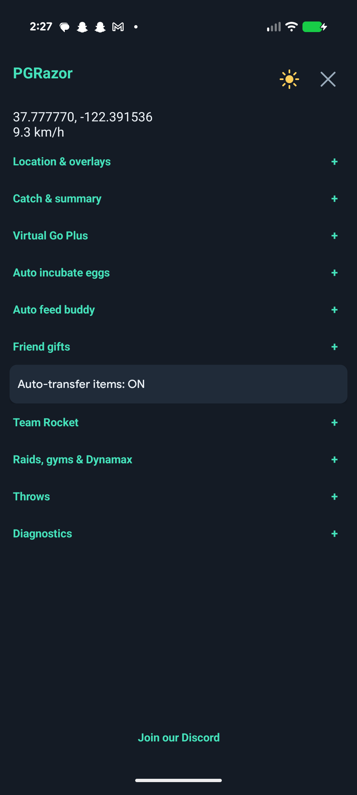

> **PGBR v0.00.01-LT** — edição independente em PT-BR. APKs gerados pelo GitHub Actions na branch `feature/pt-br-traducao`; a compilação candidata não deve publicar o pacote do jogo original. Código derivado de [jpitty03/PGRazor](https://github.com/jpitty03/PGRazor) com créditos e licenças preservados.

<p align="center"></p>
<h1 align="center">PGBR</h1>
<p align="center">A compact Android interface for location controls and Pokémon GO automation.</p>

PGBR adds an in-game menu, an independent joystick, encounter controls, and optional automation to Pokémon GO. Settings persist across restarts, with light and dark themes.

<p align="center"></p>

## Features and guides

The feature list and how-to guides live on the website, so there is one place to keep them current:

- **[PGBR website](https://github.com/LucianoToscano/PGBR)**: overview, screenshots, and the cooldown chart.
- **[Feature guides](https://github.com/LucianoToscano/PGBR?guide=all)**: where each feature is in the app and how to use it.
- **[Changelog](CHANGELOG.md)** and [release notes](https://github.com/LucianoToscano/PGBR/releases): what each version added.

## Install

There are two builds. Each release lists the Pokémon GO version it supports; native features are built for that exact version.

**PGBR (no root).** One APK for ARM64 Android phones and the MuMu emulator.

1. Open [Releases](https://github.com/LucianoToscano/PGBR/releases/latest) and download **PGBR.apk**, not a source archive.
2. Open the APK on your device and allow installation from your file manager.
3. Launch **Pokémon GO** and tap the small **R** icon for the quick menu. Choose **Settings** for the full controls.

A Play Store install is signed with a different certificate, so PGBR cannot update it in place; it replaces that copy.

**PGBR Root (experimental).** For rooted devices using the official game. It installs a Zygisk module through Magisk 27+, KernelSU, or APatch and leaves the game's APK untouched. Download **PGBR-Root.apk** from the same release and follow [the Root guide](docs/ROOTED.md).

Each release includes a changelog, SHA-256 checksums, and build information. See [installation and builds](docs/BUILDING.md) for details.

## Good to know

These are experimental client modifications. Server outcomes are not guaranteed, the cooldown timer is a local estimate, and nothing here prevents account action by the game's publisher.

## Community

Join the [PGBR Discord](https://discord.gg/9QqfkDSQX3), also linked from the settings footer. If you enjoy PGBR, you can support development on [Ko-fi](https://ko-fi.com/pgrazor). Donations are optional.

## Build and contribute

- [Build, signing, release CI, and installation](docs/BUILDING.md)
- [Architecture and compatibility](docs/ARCHITECTURE.md)
- [PGBR Root](docs/ROOTED.md)
- [Native migration verification and history](docs/NATIVE_MIGRATION.md)
- [Maintainability review and refactoring priorities](docs/MAINTAINABILITY.md)
- [Contributing and checks](CONTRIBUTING.md)
- [Third-party notices](THIRD_PARTY.md)

```powershell
python -B tools/check.py
```

Source CI runs device-free checks and compiles both the Android controls and the Root installer. Its downloadable artifact contains source and tools only, not a playable APK. Playable releases come from the manually triggered **Android release (non-root and rooted)** workflow. Signing keys, original build inputs, and investigation logs are kept out of Git.

## Repository layout

```text
.github/workflows/    Source CI, release, and website workflows
docs/                 Build, architecture, and release notes
pgrazor/src/          Android UI and control bridge
pgrazor/native/       Compiled gameplay runtime and native tests
pgrazor/art/          Compiled Android runtime bridges
pgrazor/zygisk/       PGBR Root loader
pgrazor/root-installer/  PGBR Root installer app
pgrazor/test/         Regression tests
pgrazor/vendor/       Pinned dependencies, provenance, and licenses
tools/                Checks, source packaging, release CI setup
website/              React site and feature guides, deployed to GitHub Pages
```

## License

Original PGBR source is available under the [MIT License](LICENSE). Third-party components retain their own licenses. Pokémon GO and its assets are not covered by this license. PGBR is an independent project and is not affiliated with the game publisher.
