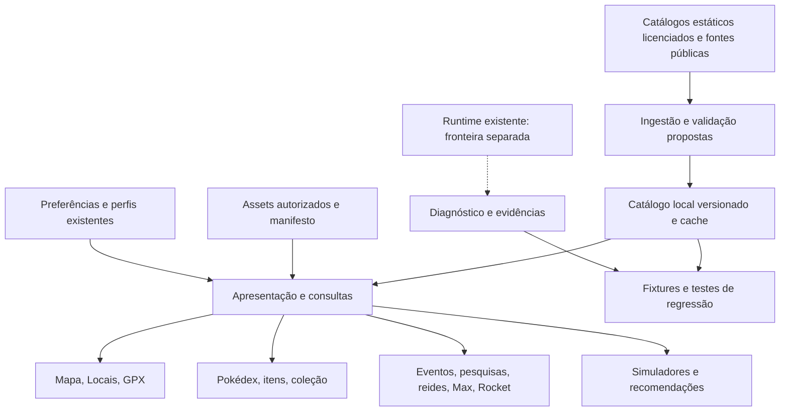

# PGBR — Mapa de recursos, catálogo técnico e evolução
Data de corte: 24/11/2026. Documento auxiliar subordinado ao [Arquivo Mestre Único](../../PGBR_ARQUIVO_MESTRE_UNICO.md), não substitui a fonte canônica. Auditoria documental e amostragem de código; não é homologação nem promessa de execução. Escopo: identificar o que existe, o que está parcial, o que corrigir, reaproveitar e propor. PokeSearch permanece separado.

## 1. Evidência e leitura do catálogo
- **F** = código ou componente identificado; **I** = integração registrada; **Q** = evidência de CI/build QA identificada, não teste físico; **P** = parcial, candidato ou pendente; **N** = proposta nova; **B** = bloqueio externo/contrato/licença. Estados podem coexistir; nenhuma linha significa homologação Android.
- Base observada nas buscas de código: `21badfd1a10e8a569c0f0e9dff8bbb4cbdb8c9d6`. Reconsultar HEAD antes de implementação. LT045 publicada como pré-release QA; LT046 candidata. Recibo histórico de build [45382217542](https://github.com/LucianoToscano/PGBR/actions/runs/45382217542); não é evidência para HEAD posterior. `device_tested=false`, `provider_connected=false`.
- Referências: [arquitetura](../ARCHITECTURE.md), [build](../BUILDING.md), [Root](../ROOTED.md), [atualização do jogo](../GAME_UPDATES.md), [terceiros](../../THIRD_PARTY.md), [LT046](../releases/v0.00.46-LT.md), [matriz](../validation/LT046_HOMOLOGACAO.md), [parciais](../validation/LT046_ITENS_PARCIAIS_20261124.md), [AGENTS](../../AGENTS.md). Não substituir contratos existentes por dados externos.

## 2. Mapa arquitetural

A nova camada de dados é somente leitura por padrão; não inicia ações no jogo, não fornece dados vivos por inferência, não modifica protocolos, não substitui o runtime. Arquitetura presente: Java em `pgrazor/src/dev/pgrazor` (Control, Pad, SettingsPanel, SettingsUi), bridges tipados e runtime C++ em `pgrazor/native`; `pgrazor/research/geolab` é laboratório isolado. Root/sem Root compartilham controles e núcleo; não alterar assinatura, nomes internos, chaves de preferências, isolamento por perfil ou fronteiras de compilação. Manter ferramentas de pesquisa fora dos pacotes de produção.

## 3. Inventário das cinco fontes externas (Drive)
Identificação por nome e estrutura; links privados não republicados no repositório público. Origem e licença precisam ser verificadas antes de copiar/distribuir código ou assets; presença no Drive não autoriza redistribuição.

| Fonte | Evidência consultada | Reaproveitamento possível | Não demonstra |
|---|---|---|---|
| WWM — 04_WatWowMap_Data | README de pogo-data-api; data/v1; index.ts; scripts/generate-sdk-metadata.ts; packages/typescript, go, rust | JSON estático, normalização, clientes tipados, traduções pt-br, catálogo offline e fixtures | Spawns/IV/coords ao vivo, servidor autenticado ou licença confirmada |
| API — 03_Pokemon_GO_API/src | CacheLoader.php; Parser, Renderer, Types, IO, Util, Collections, Logger | Adaptadores, cache, normalização, consulta de reides, pesquisas e Max, renderização de cartões | Serviço já integrado ao PGBR ou garantia de atualidade |
| MESH — Mesh | OBJ de Poképaradas, ginásio, terreno, avatar, itens e efeitos | Referências para biblioteca visual própria e testes de geometria | Câmera, projeção geográfica, texturas, animações ou permissão de redistribuição |
| SH-A — Shader (9 arquivos) | Ground, Buildings, DepthOnly, Alpha-Diffuse, Alpha-VertexLit, Holo-BRDF, Holo-BRDF_UBER, Holo-Character-Transparent(-Two)-VertexLit | Conceitos de composição, transparência, profundidade e terreno | Identificação do material que causa a tela branca |
| SH-B — Shader (20 arquivos) | MaskedGrayscale, Holo-Unlit, Holo-Glass-Fallback(-Two), Holo-Environment e Holo-Character (olhos, stencil, transparência), DepthOnly | Referência de materiais e iluminação em renderização própria | Shader completo recompilável, prova de compatibilidade em Unity atual |

### 3.1. WWM — conjuntos estáticos
Contagens declaradas no README da cópia, não contagem atual do jogo. URL upstream indicada pelo README: https://github.com/WatWowMap/pogo-data-api (verificar licença e revisão).
| Dataset | Registros | Destino proposto |
|---|---:|---|
| pokemon.json | 1025 | Pokédex, seleção, busca e simulação |
| forms.json | 1478 | Formas, identidade, deduplicação |
| costumes.json | 87 | Fantasias, proteção e requisito noEvolve |
| moves.json | 433 | Ataques e simuladores; separar dados PvP/PvE |
| items.json | 141 | Inventário e associação exata de ícones |
| invasions.json | 123 | Enciclopédia Rocket |
| location-cards.json | 180 | Coleção/cartões, não lista de coordenadas |
| quest-conditions.json | 80 | Condições de pesquisas |
| quest-reward-types.json | 21 | Tipos de recompensa |
| quest-types.json | 102 | Catálogo de missões |
| raids.json | 20 | Tipos de reide, não chefes ao vivo |
| route-types.json | 5 | Tipos de rota, não trajetos |
| teams.json | 4 | Equipes |
| types.json | 19 | Inclui None=0, 18 tipos reais; direção de eficácia deve ser validada |
| weather.json | 8 | Clima e bônus de referência |
| translations/ | 15 idiomas declarados | pt-br: pokemon, forms, moves, items, misc, quest-titles, quest-types, quest-conditions, quest-reward-types, bonuses, grunt-quotes, grunts, weather, types, costumes, lures, evolution-quests, descriptions, categorias |

Contratos: coleções em JSON e registros individuais; IDs numéricos são chaves, nunca posição no array. `costumes.json` contém lacunas e registros não lançados; noEvolve não implica disponibilidade. `types.json` tem strengths, weaknesses, veryWeakAgainst, immunes, weakAgainst e resistances: distinguir direção ataque/defesa e mapear imunidades na semântica GO, não multiplicar listas sobrepostas. Validar contra referência independente e dados versionados; desconhecido não vira neutro automaticamente. `route-types.json`: UNSET, ORGANIC, OFFICIAL, EVENT, SPONSORED; GPX pessoal é categoria interna independente.

### 3.2. API — módulos e funções
- Parser: MasterDataParser, TranslationParser, CustomTranslations, JsonMapper, PokemonGoImagesParser, LeekduckParser, PokebattlerParser, SnacknapParser e GameMaster/Struct, Collections. Adaptar somente contratos comprovados, não portar PHP inteiro para Android.
- Renderer: RaidBossListRenderer, RaidBossGraphicRenderer, MaxBattleListRenderer, ResearchTasksRenderer, PokemonRenderer, PokemonNameRenderer, Types e templates. Inspirar cartões PT-BR acessíveis.
- Types: PokemonType/Form/Image, RaidBoss/RaidLevel, MaxBattle/MaxBattleLevel, ResearchTasks, BattleResult/Configuration, PokeBattlerResult, WeatherBoost.
- IO: RemoteFileLoader, GithubLoader, JsonParser, File, Directory; CacheLoader coordena dados. Referências de Leek Duck, Pokebattler e Snacknap não provam acesso ou permissão; respeitar termos, quotas, atribuição, validade e indisponibilidade.

### 3.3. Biblioteca visual
OBJ: PokestopNear/Far, PokestopTroyDisc, pDisc, gym_mesh, fort, groundDisc, mesh_ground_whole/a/b, tree_mesh_0/1/2, SkyDomeMesh, grass_mesh, playerPulse, encounter_target, SpinnerTile, avatar, egg, incubator, potion/revive, Berry_04/05; efeitos mesh_ring/smooth/outward/wavy_curve, mesh_screen_glow, mesh_fire_blast, mesh_electric_power, mesh_slash, mesh_beam, mesh_twister, mesh_ice, mesh_splash. Usar apenas referências ou assets autorizados; preferir vetores/sprites próprios leves. OBJ não possui necessariamente material/textura; não assumir nomes como prova do efeito.
Shaders examinados: DepthOnly apresenta ColorMask 0; Holo-Character-Transparent-VertexLit tem fila Transparent, Blend SrcAlpha OneMinusSrcAlpha e propriedades ZTest/ZWrite/Cull; Ground tem offset e ramp de cor. Dumps referenciam GpuProgramID/Index e GLES, não fonte completa. Não substituir shader de terceiro nem ocultar elementos do jogo por hipótese. Testar composição no renderer próprio com cenas sintéticas, alpha, profundidade e lifecycle.

## 4. Catálogo funcional: existente, correções e evolução
P0 = regressão/segurança; P1 = consolidação; P2 = produto novo; P3 = pesquisa. Identificadores estáveis para futuras PRs, não números de versão. Entradas amplas representam famílias, não prova de cada subfunção em aparelho.

| ID | Família | Estado observado / ponto de código ou documento | Correção / evolução candidata | Prioridade |
|---|---|---|---|---|
| MAP-01 | Mapa mundial e POI | F: WorldMapDialog, MapProjection, MapTileSource/Cache, MapPoiLayer | Legibilidade, acessibilidade, cache, categorias, atribuição e indicação de fonte/idade | P1 |
| MAP-02 | Locais e favoritos | I: Mestre/#188; SavedPlaces, Hotspots, GpxStore | Biblioteca única Favoritos/Pontos/Rotas/Eventos; busca, filtro múltiplo, ordenação, +, coordenadas e cópia independente; manter perfil e ícones coerentes | P0 |
| MAP-03 | GPX e prévia | F/I: GpxStore, GpxRouteDialog, GpxCodec; #167/#172 | Multi-segmento, nomes Unicode, limites, distância, edição, progresso, exportação e importação segura | P1 |
| MAP-04 | Rota visual pessoal | I/P: #176/#183/#185 | Rota GPX/Caminhar até aqui exclusivamente visual; progresso, cores, espessura e destino; modo automático só com interface autorizada e validação de projeção. Calibração inicial ainda manual | P1/P3 |
| MAP-05 | Rotas oficiais | I/P: GameRoutesController/Dialog, #183/#187 | Preservar separação, fluxos oficiais e recompensas; revalidar regressões com uso autorizado e sem ação automática nova | P0 |
| MAP-06 | Joystick, movimento e GPS | F: Pad, MotionEngine, AutoWalkPlanner, GameLocationDelivery | Ergonomia, estados de pausa, diagnóstico, compatibilidade Android; sem ampliar manipulação de localização ou contornar controles | P1 |
| MAP-07 | Pontos e mapas temáticos | N: catálogos de POI e mapas autorizados | Camadas por interesse, localização real/planejada, filtros, prévia 3D própria, favoritos offline | P2 |
| COL-01 | Espécies e seleção | F: PokemonCategories, PokemonOptionFilter, PokemonSpeciesDialog, PokemonSelectorPolicy | Unificar IDs, formas e sprites; manter filtro conhecido/desconhecido | P1 |
| COL-02 | Coleção, IV, nível e proteção | I/P: LT046 prévia individual/lote, etiquetas tri-state | Revisar positivos/negativos e ausência de dados; preservar favoritos, shiny, XXL/XXS, fantasia, fundo e formas; nenhuma classificação isolada autoriza transferência | P0 |
| COL-03 | Evoluções, MT e fortalecimento | F/P: evolve_transfer.cpp, batch_evolution.cpp, #134, matriz QA | Consulta de requisitos, custo, ataques elegíveis e legados; simulador de PC/IV; prévia sem gastar recursos; confirmar fontes e eventos | P1 |
| COL-04 | Pokédex e coleção visual | N: WWM + sprites autorizados | Busca por geração, tipo, forma, fantasia, fundo, shiny; checklist manual, progresso, filtros e exportação local | P2 |
| COL-05 | Ranks PvP e avaliação | P/N: simulador local LT046 | Rank por liga/limite de PC, nível, IV e versão da tabela; comparar evoluções, mostrar pressupostos | P2 |
| INV-01 | Inventário e ícones | F/I: ItemBadge, ItemSpriteFit, LiveFeedIcons, #174/#181; galeria por ID | Poeira estelar, frutas, bolas, MT, incubadoras, evolução, módulos, poções e revives; auditoria de correspondência ID/asset, fallback legível; só assets licenciados | P0 |
| INV-02 | Gestão de itens | F: arquitetura, inventário65; LT046 planejamento local de frutas | Resumo, reservas e alertas; prévia de consumo sem ações irreversíveis; alertas de limite | P1 |
| CAP-01 | Captura, Quick Catch, Hunt/Farm/Transfer | F/P: Control, CatchOutcomeController, VgpController, release/mestre | Preservar interface e preferências; revisar feedback, Lenta 3s, estados e proteção; testar em fixtures sem ampliar automação do jogo | P0 |
| VGP-01 | VGP+ | I/P: LT045, VgpController; etiquetas/raridade #133 pendentes | Classificação e etiquetas locais; status correto, não confundir dado desconhecido com ausência; preservar proteção e compatibilidade | P0 |
| FEED-01 | Sniper 1/2, Radar, Savant, coletor IV100 | I/P: LT045 QA; SourceQuery, LiveFeedClient/Data/Filters/Dialog | Identificação e filtros de catálogo; rótulo de fonte/idade/ausência; nenhum feed privado ou coordenadas ao vivo presumidas. Provedor autorizado obrigatório | P1/B |
| BAT-01 | Rocket: tela branca carregado | P: #193 HEAD 955eb76aaf9c48e1a25d0f51f741608fe8fa002f, ainda não merged na consulta | Prioridade Rocket por ser fluxo compartilhado; documentar fase, comparar registros e visibilidade em ensaio autorizado; investigar material/overlay próprio e regressão sem remover função; efeito discreto somente em UI própria; nenhuma causa comprovada | P0 |
| BAT-02 | Supereficaz e Ataque Inteligente | P: #193 candidata, política local e matriz | Validar types/moves como referência independente; simulações de tipo simples/duplo, resistências, metadados desconhecidos, dois carregados; separar recomendação local da execução real | P0 |
| BAT-03 | PvP e treinamento | P: política local, testes, #90/#105 | Simulador, recomendação de equipes, diagnóstico de lifecycle/rearme; não declarar executor homologado | P0 |
| BAT-04 | Reides e ginásios | F/P: arquitetura, runtime e histórico LT; API RaidBoss/Pokebattler | Central de chefes, counters, tipos, clima, custos, equipe manual; avisos de agenda e disponibilidade | P2 |
| BAT-05 | Max / Dynamax / Gigantamax | P: AutoMaxBattleSessionTest, preparação manual #174, #131/#154 pendentes | Central Max, papéis, elegibilidade, partículas, custos, sugestões de equipe; sem iniciar/gastar recursos automaticamente | P1/P2 |
| BAT-06 | Central Rocket | N: invasions + grunt-quotes/grunts | Frases, possíveis equipes e fraquezas; mostrar fonte, data e incerteza, consulta manual | P2 |
| EVT-01 | Eventos | I: #66, histórico LT033; menu Evento e Locais no Mestre | Calendário oficial, hoje/próximos, horários locais, bônus, espécies e ataques exclusivos, links e fontes; cache e expiração | P1 |
| EVT-02 | Missões e pesquisas | F/P: research e busca documentadas; Quest types/conditions/rewards | Catálogo pesquisas de campo, temporárias, especiais, coleções e recompensas; checklist manual, alertas, filtros por item/espécie | P1/P2 |
| EVT-03 | Planejador de eventos | N: integração de dados públicos autorizados | Agenda, lembrete opt-in, dia comunitário, hora destacada, hora de reide, GO Fest/Tour, Max, Rocket, bônus e janelas de evolução; fuso IANA e mudança de data; nada de ações de jogo agendadas | P2 |
| EVT-04 | Presets e rotinas locais | N: preferências e eventos | Perfis de interface, filtros de consulta, lembretes, lista de tarefas e planejamento; prévia, confirmação, botão cancelar, histórico e reversão | P2 |
| AUX-01 | Companheiro, ovos, presentes, medalhas | F/P: histórico e estados PT-BR no Mestre; escopo detalhado ainda não auditado | Painel manual de progresso, planejamento de incubação, alertas e glossário; não inventar estado de conta | P2 |
| AUX-02 | Eternatus e funções sazonais | F/P: AGENTS e histórico; guardas já documentados | Catálogo sazonal, checklist e diagnóstico; preservar fluxo existente, sem conceder progresso por inferência | P1 |
| SYS-01 | UI, menu e tradução | F: Pad, SettingsPanel, SettingsUi, SettingsSearch | PT-BR integral (catch/xfer/feeding e outros), estados, rótulos de acessibilidade, escala de fontes, tema claro/escuro, tablet | P0 |
| SYS-02 | Estatísticas | F: SessionStats, SessionStatsHistory e testes | Painel 1h/24h, histórico, metas, exportação sanitizada, taxas com denominadores explícitos; sem afirmar exatidão antes de QA | P1 |
| SYS-03 | Perfis, contas e privacidade | F: AccountProfileStore/Profiles/Dialog/SessionVault, SettingsWriter | Preservar isolamento, máscara local e backup; diagnóstico sem dados pessoais; exclusão e exportação explícitas | P0 |
| SYS-04 | Cofre e IA opcional | I/P: #168/#173; prévia independente; sem provedor | BYOK somente com consentimento, Keystore, limite de gasto, explicação de envio, revogação, fallback; assistente de catálogo, sem ações de jogo | P2/B |
| SYS-05 | Dados e cache | N: Data Engine; já existem MapTileCache, cache de sprites, catálogos específicos | Normalizar, validar e atualizar snapshot offline por versão, checksum, rollback e adaptadores; não duplicar componentes existentes | P1 |
| SYS-06 | GeoLab | I/P: #165, pesquisa separada | Laboratório de desempenho para dados geográficos públicos/sintéticos, não runtime de produção | P3 |
| SYS-07 | QA, build e release | I/Q: workflows e matriz LT046 | Rastrear HEAD, fixtures, assinatura/hashes, três variantes, QA Android; não publicar sem autorização explícita | P0 |
| SYS-08 | Governança e documentação | F: Mestre e AGENTS | Catálogo por ID, mapa de dependências, registro de regressões, licenças, fonte e data; resolver conflito documental preexistente em PR separada | P0 |

## 5. Backlog de implementação de dados, eventos e automações locais
| ID | Entrega futura | Critério verificável |
|---|---|---|
| DATA-01 | Inventário de bases já embarcadas e IDs | Diff contra WWM por revisão, sem substituir dados existentes cegamente |
| DATA-02 | Manifesto de proveniência | Fonte, revisão, licença, hash, esquema, data, validade, atribuição e permissões de cada dataset/asset |
| DATA-03 | Modelo comum e cache offline | IDs estáveis e namespace por tipo; atualização atômica, snapshot anterior preservado, tamanho limitado, migração testada |
| DATA-04 | Traduções PT-BR | Chaves por categoria, fallback explícito, glossário de rótulos próprios separado de textos externos |
| DATA-05 | Validação de tipos, ataques e formas | Fixtures com dados desconhecidos, dual-type, resistências, mudanças de moves, fantasia não lançada; sem usar metadados como prova de disponibilidade |
| DATA-06 | Itens e sprites | Manifesto ID→arquivo autorizado, hash, dimensões, transparência, fallback, relatório de faltantes, testes de colisões |
| EVT-05 | Ingestão de calendário | Fontes oficiais prioritárias; termos e atribuição; atualização por ETag/TTL quando suportados, horário local versus UTC, eventos expirados não ativos |
| EVT-06 | Motor de lembretes locais | Opt-in, notificações Android, fuso IANA, cancelamento/edição, deduplicação, sem disparo de ações no jogo |
| EVT-07 | Checklist inteligente | Plano diário/semanal manual; progresso confirmado pelo usuário, prioridades, reset por janela, estado desconhecido explícito |
| EVT-08 | Central de bônus e janelas | Mostrar bônus, pesquisa, reide, Max, Rocket, ataques exclusivos com fonte, intervalo e elegibilidade; sem inferir garantia |
| AUTO-01 | Catálogo de rotinas | Apenas rotinas de dados, atualização, cache, notificação, exportação e planejamento; opt-in, estado, auditoria, limites, pausa e cancelamento |
| AUTO-02 | Regras de segurança | Nenhuma nova ação irreversível; teste de presets sem execução; não alterar runtime existente por integração de dados |
| VIS-01 | Renderização própria | Canvas/vetores ou renderer independente; assets autorizados, benchmark em aparelho e fallback 2D |
| VIS-02 | Rota visual automática | Pesquisa de interface de projeção autorizada; teste de perspectiva, zoom, rotação, perda de referência; se indisponível, usar mapa próprio e deixar overlay experimental |
| QA-01 | Tela branca | Reproduzir primeiro Rocket, vídeo/log sanitizado, identificar camada real, comparar antes/depois, preservar visibilidade e interações legítimas; depois testar PvP/treino |
| QA-02 | Suporte e regressão | Matriz Root/sem Root, troca de tela, tema, resolução, permissões, versão Android, carga, memória, bateria; sem marcar como executado até evidência |

## 6. Roadmap por ondas (não altera VERSION)
1. **Estabilização LT046/P0:** tela branca Rocket (depois modos derivados), Supereficaz, Locais/Rotas oficiais separadas, PT-BR, velocidade lenta, ícones, proteção de coleção. Respeitar PR #193 e trabalho paralelo; não duplicar patches.
2. **Fundação de dados/P1:** inventário do já existente; validar licenças; schema e manifestos; tipos, itens, formas, traduções, cache; fixtures e relatórios de diferenças; catálogo local somente leitura.
3. **Centrais/P2:** Eventos e Missões, Pokédex/coleção, Rocket, Reides, Max, simuladores PvP/PvE; alertas e planejamento manual; usar módulos existentes e preservar menus.
4. **Qualidade/P1-P2:** UI acessível, estatísticas, relatórios e exportação; agendamento de atualização e lembretes, modo offline, preferências e segurança por perfil.
5. **Pesquisa/P3:** gráficos próprios e trajetória visual automática com limites explícitos; GeoLab separado; não prometer fonte ao vivo nem projeto de renderização nativa sem interface autorizada.

## 7. Regras de integração, critérios e manutenção
- Não copiar arquivos do Drive para repo público sem licença/autorização. Não publicar links privados, dados pessoais, chaves ou APKM. Preservar THIRD_PARTY e atribuições. Não executar scripts externos sem revisão.
- Priorizar dados oficiais/abertos licenciados; quando houver conflito registrar fonte, versão, contexto e confiança. Fail closed para identificadores desconhecidos, sem inventar registros.
- Toda fonte externa deve permitir uso, ter contrato quando necessário, timeout, backoff, rate limit, cache e status de indisponibilidade. Nunca confundir catálogo estático com encontro/IV/coord ao vivo. Nenhum novo acesso privado, bypass ou integração de execução automatizada de jogo.
- PR pequena por família, checar dependências e HEAD, não modificar arena/ nem resolver histórico automaticamente. Testes host/fixtures, CI exato, build assinado, homologação física e publicação são evidências distintas. Toda entrega registra ID(s) deste catálogo no Mestre único, incluindo commit, arquivos, resultados e lacunas.
- Atualizar o catálogo por diff e manter histórico no Mestre; propostas novas são N até existir código; nunca anunciar funcionalidade com base somente em nomes de classes ou arquivos. Revisão por família antes de cada release. Nenhum teste de dispositivo ou build executado nesta auditoria documental.
